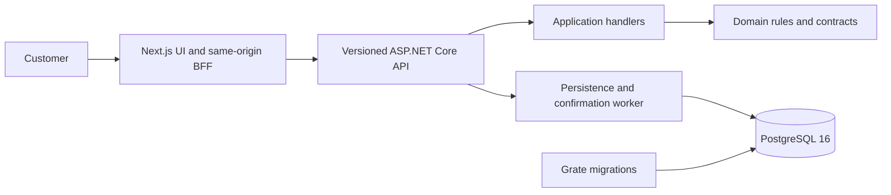

# Capitec Transaction Dispute Portal

An independent local demonstration of a customer transaction-dispute journey. Customers use synthetic data to review transactions, submit a dispute, and follow its status and confirmation. It is not connected to or endorsed by Capitec Bank.

**Status:** Local assessment application. There is no configured production deployment or CI pipeline.

## Contents

1. [Solution overview](docs/solution/solution.md)
2. [Application guide](docs/application/application.md)
3. [Deployment status](docs/deployment/deployment.md)
4. [Local development](docs/development/local-development.md)
5. [Product specification](docs/specs/product-spec.md)
6. [Technical specification](docs/specs/technical-spec.md)
7. [Architecture decisions](docs/decisions/)
8. [Runbooks](docs/runbooks/local-troubleshooting.md)
9. [Web application](web/README.md)

## Architecture



## Quick start

Prerequisites: .NET SDK 10.0.300, Docker Desktop with Compose, and Node.js 22.12+ with npm for running web checks outside Docker.

```sh
cd src
docker compose up -d --build
```

Open the [web app](http://localhost:8080). The local API's [Swagger UI](http://localhost:5147/swagger) is available in Local and Development environments. Compose loads PostgreSQL 16, applies Grate migrations, and starts the API and web application with synthetic demo data.

## Verify

```sh
dotnet test Capitec.Transactions.DisputePortal.sln
cd web
npm ci
npm run quality
PLAYWRIGHT_BASE_URL=http://localhost:8080 npm run test:e2e
```

The .NET integration tests and browser tests require Docker and a running Compose stack respectively. See [Local development](docs/development/local-development.md) for setup, configuration, reset, and individual test commands.
