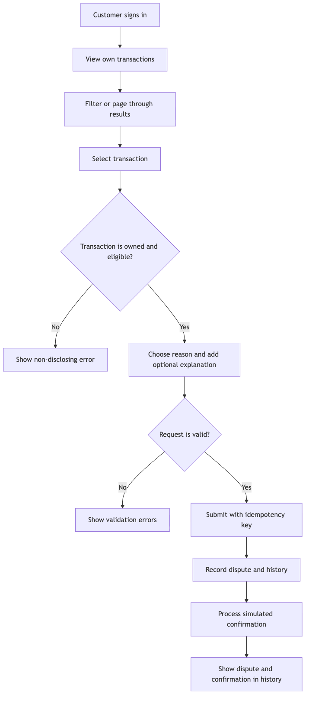
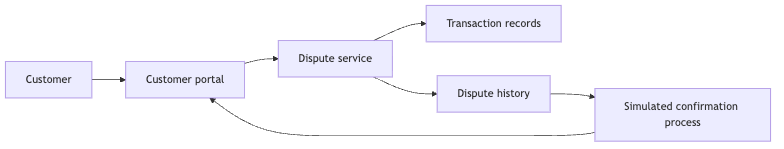

# Product Specification: Transaction Dispute Portal

## 1. Document Control

| Field | Value |
|---|---|
| Version | 1.1 |
| Status | ✅ APPROVED |
| Created | 2026-10-18 |
| Last Modified | 2026-10-18 |
| Author | Siphesihle Dube |
| Reviewers | Siphesihle Dube (Engineering Lead) |

### Changelog

| Version | Date | Changes | Changed By | Approved By | Role | Approval Date |
|---|---|---|---|---|---|---|
| 1.0 | 2026-10-18 | Initial assessment scope | Siphesihle Dube | Siphesihle Dube | Engineering Lead | 2026-10-18 |
| 1.1 | 2026-10-18 | Select PostgreSQL 16 with Grate for local portability and native Apple Silicon support. | Siphesihle Dube | Siphesihle Dube | Engineering Lead | 2026-10-18 |

## 2. Executive Summary

The Transaction Dispute Portal is a customer-facing assessment application. It lets a customer view synthetic account transactions, submit a dispute, and review current and historic disputes. It demonstrates a banking workflow with customer data isolation, an auditable dispute history, idempotent submission, and a simulated confirmation. It is an independent assessment project, not a Capitec Bank service and not connected to bank systems.

## 3. Product Overview

### What is this product?

A web application and API that demonstrate the customer side of a transaction dispute journey. The application uses synthetic data and a simulated identity and confirmation flow.

### Key features

| # | Feature | Description |
|---|---|---|
| 1 | Transaction history | View, filter, and page through the signed-in customer's transactions. |
| 2 | Dispute submission | Select a transaction, provide a reason and optional explanation, and submit once. |
| 3 | Dispute history | Review dispute status and a time-ordered history of recorded events. |
| 4 | Simulated confirmation | Show an in-app confirmation after the dispute is accepted. |

### Target users

The only interactive persona in this assessment is a retail banking customer. Staff review and administration screens are out of scope. Historic statuses may be represented by synthetic seed records.

## 4. Objectives and Success Metrics

| # | Objective | Success metric | Target | Measurement |
|---|---|---|---|---|
| O-01 | Demonstrate the required customer journey. | Customer can view a transaction, submit a dispute, and find it in history. | One complete journey succeeds in automated end-to-end tests. | Playwright run against the Docker stack. |
| O-02 | Protect customer transaction privacy. | Cross-customer reads and writes are denied. | 100% of defined positive and negative authorization tests pass. | API integration tests using two seeded customers. |
| O-03 | Avoid duplicate dispute creation. | Repeated requests with the same idempotency key create one dispute. | Exactly one dispute and one confirmation work item. | Concurrent API integration test. |
| O-04 | Demonstrate high-volume readiness. | Indexed, bounded transaction reads remain responsive on a large synthetic dataset. | Proposed benchmark: 1,000,000 transactions, 100 concurrent clients, 100 requests/second for 10 minutes; read p95 ≤ 500 ms, write p95 ≤ 1,000 ms, unexpected error rate < 1%. | Repeatable load test with hardware and Docker resource limits recorded. This is an assessment target, not a Capitec production SLA. |

## 5. Scope

### In scope

| # | Item | Rationale |
|---|---|---|
| 1 | Customer demo sign-in using seeded identities. | Enables customer-scoped demonstration without a real identity provider. |
| 2 | View and filter synthetic transactions with bounded pagination. | Required to find a transaction and supports large data volumes. |
| 3 | Submit a transaction dispute and see the result. | Core assessment capability. |
| 4 | View current and historic disputes with a status/event timeline. | Satisfies the historic view and makes changes traceable. |
| 5 | Simulate an in-app confirmation. | Required simulated confirmation, without an external messaging dependency. |
| 6 | Run the application and database locally with Docker. | Required assessment delivery and repeatable evaluation. |

### Out of scope

| # | Item | Rationale |
|---|---|---|
| 1 | Real Capitec authentication, account data, or transaction integrations. | No bank access is provided; use synthetic data only. |
| 2 | Staff case-management, investigation, or resolution screens. | The brief names customer actions only. |
| 3 | Real email, SMS, push notifications, or payment reversals. | Confirmation is simulated; no real side effects are permitted. |
| 4 | Production deployment, regulatory certification, or production service-level commitments. | This is a take-home assessment, not an approved bank deployment. |

## 6. Assumptions and Constraints

| # | Type | Description | Impact if wrong | Owner | Status |
|---|---|---|---|---|---|
| AC-01 | Assumption | The portal is customer-only; staff workflows are excluded. | Scope and API permissions change. | Product reviewer | Open |
| AC-02 | Assumption | Demo sign-in selects or uses one of a small set of seeded synthetic customers. | Demo journey and security model change. | Product reviewer | Open |
| AC-03 | Assumption | A dispute requires a reason from a fixed list and may include a short explanation. | Request validation and interface change. | Product reviewer | Open |
| AC-04 | Assumption | A customer may have at most one active dispute per transaction; a new dispute after a terminal status is not defined yet. | Duplicate rules and history behavior change. | Product reviewer | Open |
| AC-05 | Assumption | Dispute status history is append-only. New customer submissions enter `Submitted`; historical seed data may show later statuses. | Historic view and workflow change. | Engineering Lead | Open |
| AC-06 | Assumption | The benchmark in O-04 is a proposed assessment target, not an observed Capitec workload. | Capacity claims must be changed or removed. | Engineering Lead | Open |
| AC-07 | Constraint | All names, identifiers, accounts, and transactions used in the demo are synthetic. | Real data would create privacy and security risk. | Project author | Confirmed |
| AC-08 | Constraint | The solution must include a runnable Dockerfile and a README with build, run, and test steps. | Submission would not meet the assessment instructions. | Project author | Confirmed |

## 7. User Personas

### Retail banking customer

| Field | Detail |
|---|---|
| Role | Customer using the demo portal. |
| Goals | Find a transaction, report a problem, and understand what was submitted. |
| Needs | Clear transaction details, safe submission, confirmation, and dispute history. |
| Pain points | Unclear dispute status, repeated submissions, and difficulty finding older activity. |
| Typical behaviour | Signs in, filters recent activity, submits a dispute, then checks its status later. |

### RACI

| Activity | Customer | Portal | Assessment owner |
|---|---|---|---|
| View own transactions | R | A | I |
| Submit dispute | R | A | I |
| Record dispute history and confirmation | I | R/A | I |
| Approve product policy | C | I | R (authorized reviewer required) |

## 8. User Journeys

### Find a transaction and submit a dispute

| Field | Detail |
|---|---|
| Actor | Retail banking customer |
| Goal | Report a problem with a transaction and later find the dispute. |
| Preconditions | Customer has an authenticated demo session and synthetic transactions. |
| Trigger | Customer notices a transaction they do not recognise or wants to query. |

| Step | Customer action | System response |
|---|---|---|
| 1 | Signs in with a demo identity. | Establishes a customer-scoped session. |
| 2 | Opens transactions and applies filters or pagination. | Returns only that customer's transactions, newest first. |
| 3 | Opens a transaction and chooses a dispute reason. | Shows relevant transaction details and validates eligibility. |
| 4 | Submits the dispute. | Creates one dispute and records its initial history event. |
| 5 | Views confirmation and opens dispute history. | Shows the accepted dispute and its current status/history. |

**Postconditions:** One dispute exists for the accepted request, its history is visible to its owner, and one simulated confirmation is recorded.

**Exception flows:** Unauthenticated requests are rejected; another customer's transaction is not disclosed; invalid reasons are rejected; duplicate retries return the original result; unavailable confirmation processing leaves the accepted dispute visible and the confirmation pending for retry.

*Diagram source: `diagrams/flows/journey-submit-dispute.mmd`*

## 9. Functional Requirements

### Customer access and transaction history

| # | Requirement | Description | Acceptance criteria | Priority |
|---|---|---|---|---|
| FR-01 | Demo customer access | Authenticate a seeded synthetic customer. | Anonymous calls are rejected; requests from customer A cannot read customer B's transactions or disputes. | Must |
| FR-02 | Transaction history | List the signed-in customer's transactions, newest first, with date and type filters. | Results are customer-scoped; page size is capped at 50; next-page traversal has no duplicates or gaps for a stable dataset. | Must |
| FR-03 | Transaction detail | Show a selected transaction's date, merchant/description, amount, currency, and masked account reference. | Unknown IDs and IDs owned by another customer return the same non-disclosing not-found response. | Must |

### Disputes and confirmation

| # | Requirement | Description | Acceptance criteria | Priority |
|---|---|---|---|---|
| FR-04 | Submit dispute | Submit for an eligible transaction with a reason and optional explanation. | Valid input creates a `Submitted` dispute; invalid reason, blank required fields, or explanation over 500 characters is rejected with a useful validation response. | Must |
| FR-05 | Idempotent submission | Safely handle client retries. | Replaying the same idempotency key and request returns the original dispute; it does not create another dispute or confirmation work item. | Must |
| FR-06 | Dispute history | List current and historic disputes for the signed-in customer. | Each item includes transaction summary, reason, current status, and ordered history events; another customer cannot read it. | Must |
| FR-07 | Simulated confirmation | Record and show a confirmation after submission. | Confirmation processing is separate from the submission response; temporary processing failure does not lose the accepted dispute and can be retried. | Must |
| FR-08 | Historic status display | Show seeded examples in submitted, under-review, resolved, or rejected states. | Status labels and event order match the fixture data; customers cannot change statuses. | Should |

## 10. Non-Functional Requirements

| # | Category | Requirement | Target | Priority |
|---|---|---|---|---|
| NFR-01 | Performance and volume | Support the proposed benchmark in O-04 with bounded transaction reads. | 1 million synthetic transactions; 100 concurrent clients; 100 requests/second for 10 minutes; read p95 ≤ 500 ms, write p95 ≤ 1,000 ms, unexpected error rate < 1%. Record hardware and resource limits. | Should |
| NFR-02 | Horizontal scaling | API instances do not depend on in-process customer session state. | Run two API instances against the same database; the same authorization and idempotency tests pass through either instance. | Must |
| NFR-03 | Reliability | A database commit and its confirmation work item are atomic. | Fault-injection test proves no accepted dispute lacks a durable confirmation work item; worker retries do not create duplicate confirmations. | Must |
| NFR-04 | Security | Enforce authentication and ownership for every customer data operation. | All anonymous and cross-customer positive/negative API tests pass; no real PII or secrets are included in source or logs. | Must |
| NFR-05 | Accessibility | Customer journey is keyboard operable and has programmatic labels and status announcements. | Automated accessibility scan has no serious/critical findings on primary journey; manual keyboard check passes. | Should |
| NFR-06 | Responsive UI | Main customer flows work on phone and desktop viewports. | No horizontal page overflow at 360 px and 1280 px widths; all controls remain usable. | Must |
| NFR-07 | Local reproducibility | The application can be built, started, and tested from a clean checkout. | README commands succeed using Docker and documented prerequisites only. | Must |

## 11. Data Requirements

### Inputs and outputs

| Data | Source/destination | Format and frequency | Description |
|---|---|---|---|
| Transactions and demo customers | Synthetic seed data | Version-controlled fixtures loaded for local demonstration | No real bank or customer data. |
| Dispute request | Customer interface to portal | Versioned API request per submission | Transaction reference, reason, optional explanation, idempotency key. |
| Confirmation | Portal confirmation history | In-app record after asynchronous simulation | No external email, SMS, or push delivery. |

### Data structures

Customer owns transactions and disputes. A dispute references one transaction, has a current status, and has an append-only sequence of history events. A confirmation work item is associated with the dispute. Monetary amounts use integer minor units (`long`) and a currency code; the currency determines display precision.

### Data governance

| Concern | Approach |
|---|---|
| Retention | Assessment data only; local database volume is removable. Production retention is not defined. |
| Classification | Synthetic demo data; never use real customer or account details. |
| PII handling | Do not request or store real identity, card, or account data. Mask synthetic account references in the UI. |
| Archival | Not in scope. |
| Purge | Remove the local database volume to reset the demo. Production deletion policy requires approval. |

## 12. Product Components

| # | Component | Responsibility | Interacts with |
|---|---|---|---|
| 1 | Customer portal | Present transaction, dispute, and history journeys. | Customer, dispute service. |
| 2 | Dispute service | Check ownership, accept disputes, and provide dispute history. | Customer portal, transaction records, history. |
| 3 | Transaction records | Provide synthetic customer transaction data. | Dispute service. |
| 4 | Confirmation process | Record and display a simulated confirmation. | Dispute service, customer portal. |

*Diagram source: `diagrams/architecture/overview.mmd`*

## 13. Dependencies

| # | Dependency | Type | Owner/vendor | Impact if unavailable | Mitigation |
|---|---|---|---|---|---|
| D-01 | Docker Engine and Compose | Local runtime | Docker | Local stack cannot start. | Document version/prerequisites and provide direct development commands. |
| D-02 | PostgreSQL 16 container | Local data store | PostgreSQL | Persistence and API workflows are unavailable. | Health checks, startup dependency checks, and documented reset procedure. |
| D-03 | Capitec public website logo and visual reference | Design reference | Capitec Bank | Brand asset may change or usage may not be permitted. | Pin a local copy with source attribution; label the project independent and not endorsed. |

## 14. Risks and Mitigations

| # | Risk | Likelihood | Impact | Mitigation | Owner | Status |
|---|---|---|---|---|---|---|
| R-01 | Assessment branding may be mistaken for an official Capitec service. | Medium | High | Display an independent-demo notice; use only public brand reference assets; do not use real customer data. | Project author | Open |
| R-02 | Proposed benchmark is mistaken for proven production capacity. | Medium | High | Label results as assessment-only, document test hardware, and make no production SLA claim. | Project author | Open |
| R-03 | Re-dispute and eligibility rules are not stated in the brief. | High | Medium | Keep these as open product decisions; enforce only the agreed active-duplicate rule. | Product reviewer | Open |
| R-04 | The Grate container runs as amd64 under emulation on Apple Silicon. | Medium | Medium | Pin the Grate image, set `platform: linux/amd64`, and verify migration startup in Docker Compose. | Project author | Open |

## 15. UX/UI Considerations

### Design principles

- Use the Capitec public site as a brand reference, not as a banking-app layout to copy.
- Use deep blue `#0033A0`, action blue `#2F70EF`, logo red `#E63934`, and blue-teal `#00486D` with neutral surfaces and readable contrast.
- Use Flama for headings and Nunito Sans for body text when locally available; do not make the site depend on a third-party font request at runtime.
- Keep the interface focused on repeated customer tasks: transaction list, dispute form, status, and history.
- Make mobile and desktop layouts responsive; keep transaction rows scannable and avoid nesting framed cards.
- Include a visible independent-assessment notice. The official logo asset source is `https://www.capitecbank.co.za/Static/capitec_v2/dist/assets/images/capitec-logo-small.svg`.

### Key UX decisions

| Decision | Rationale |
|---|---|
| Use an operational banking dashboard rather than a marketing landing page. | Customers need to find and act on transactions quickly. |
| Show confirmation and status history in the portal. | The brief requires simulated confirmation and historic disputes. |
| Display integer minor units as formatted ZAR amounts. | Prevents floating-point monetary arithmetic while keeping amounts familiar. |

## 16. Regulatory and Compliance Requirements

| # | Requirement | Standard | Product impact | Approach |
|---|---|---|---|---|
| RC-01 | Protect personal information. | POPIA principles are a design reference; this assessment is not a compliance certification. | Real customer data and production integrations are excluded. | Use synthetic data, enforce customer ownership, minimize logged data, and label compliance claims accurately. |
| RC-02 | Avoid false affiliation or endorsement. | Capitec trademark and brand rights. | Public branding is used only to demonstrate visual reference. | Mark the solution independent and not endorsed; confirm asset-use rights before public release. |

## 17. Implementation Roadmap

| Phase | Scope | Target date | Milestone |
|---|---|---|---|
| 1 | Review and approve product specification. | TBD | Product scope approved by an Engineering Lead or Product Manager. |
| 2 | Draft and approve technical specification. | TBD | Architecture, data lifecycle, and scale test approach approved. |
| 3 | Implement API, web app, persistence, and demo flow. | TBD | Dockerized end-to-end journey works. |
| 4 | Validate tests, load benchmark, accessibility, and documentation. | TBD | Submission evidence is reproducible from README. |

## 18. Testing and Acceptance Criteria

### Test strategy

Use unit tests for dispute rules and validation, API integration tests for authorization/idempotency/persistence, Playwright tests for the complete customer journey, an accessibility check for key screens, and a repeatable load test for NFR-01. Include positive and negative API tests.

| # | Criteria | Linked requirement | Validation |
|---|---|---|---|
| UAT-01 | A customer can view an owned transaction, submit a dispute, and see it in history. | FR-01 to FR-07 | Playwright end-to-end test. |
| UAT-02 | A customer cannot read or dispute another customer's transaction. | FR-01, FR-03, FR-06, NFR-04 | API integration tests for allowed and denied requests. |
| UAT-03 | Retry of a submission does not create duplicate records or confirmations. | FR-05, NFR-03 | Concurrent integration test. |
| UAT-04 | Proposed scale benchmark meets recorded latency and error targets. | O-04, NFR-01 | Repeatable load test; publish workload and environment with results. |
| UAT-05 | Local stack can be built, started, tested, and reset using documented commands. | FR-07, NFR-07 | Clean-checkout verification. |

## 19. Release and Deployment Plan

| Field | Detail |
|---|---|
| Rollout strategy | Assessment submission; no production rollout. |
| Environments | Local Docker Compose and CI. |
| Rollback | Stop containers and remove the local data volume to reset synthetic state. |
| Go-live criteria | Product and technical spec approval, automated tests pass, Docker run is reproducible, and README is complete. |
| Go-live date | TBD; assessment deadline not supplied. |

## 20. User Adoption and Support

| Field | Detail |
|---|---|
| Training | README and seeded demo account instructions. |
| Communication | GitHub repository link supplied to the assessment contact. |
| Support | Assessment author during review. |
| SLA | None; not a production service. |
| Monitoring | Local structured logs, health endpoints, and benchmark output. |
| Feedback | Interview discussion and reviewer feedback. |

## 21. Appendices

### Glossary

| Term | Definition |
|---|---|
| Minor unit | Smallest supported unit of a currency, such as one cent for ZAR. |
| Idempotency key | Client-provided key that makes a retried submission return the original outcome. |
| Historic dispute | A prior dispute and its recorded statuses/events, including seeded synthetic examples. |
| Outbox | Durable work record used to process a simulated confirmation after the dispute is committed. |

### References

- Assessment brief: Transactions Dispute Portal, provided by the user.
- Capitec public site: https://www.capitecbank.co.za/
- Official public logo path: https://www.capitecbank.co.za/Static/capitec_v2/dist/assets/images/capitec-logo-small.svg
- Reference implementation: https://github.com/Sphexdube/Capitec.TransactionSystems.Aggregator

## Approval Record

| Field | Value |
|---|---|
| Status | ✅ APPROVED |
| Approved By | Siphesihle Dube |
| Role | Engineering Lead |
| Approval Date | 2026-10-18 |
| Version Approved | 1.1 |