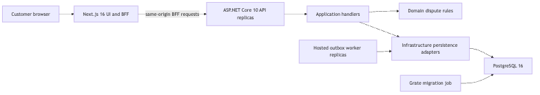
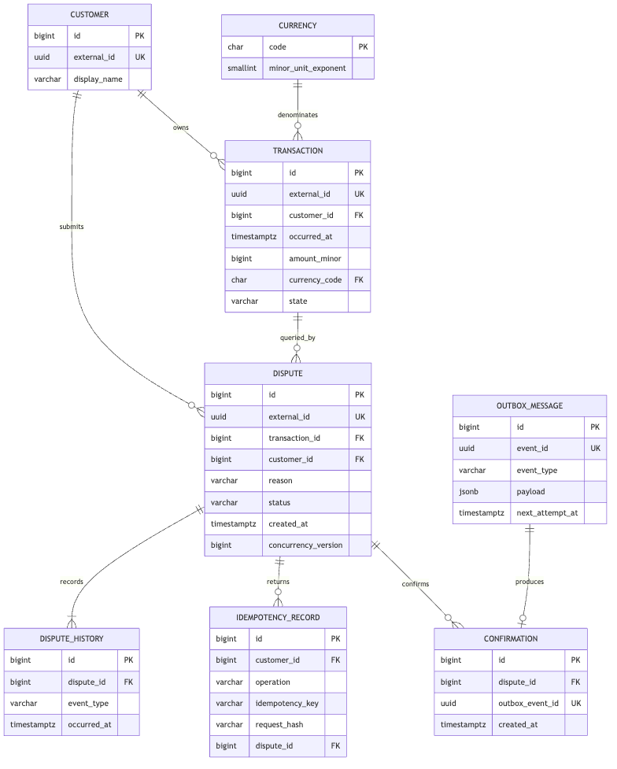
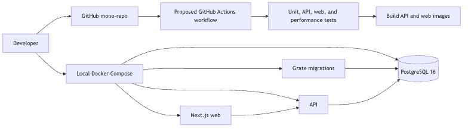

# Technical Specification: Transaction Dispute Portal

| Field | Value |
|---|---|
| Version | 1.0 |
| Status | ✅ APPROVED |
| Product Spec Version | 1.1 |
| Created | 2026-10-18 |
| Last Modified | 2026-10-18 |

## Changelog

| Version | Date | Changes | Changed By | Approved By | Role | Approval Date |
|---|---|---|---|---|---|---|
| 1.0 | 2026-10-18 | Initial technical design | Siphesihle Dube | Siphesihle Dube | Engineering Lead | 2026-10-18 |

## 1. Architecture Overview

The system is a stateless modular monolith. A Next.js 16 application serves the customer UI and a same-origin Backend-for-Frontend (BFF). The BFF forwards versioned requests to an ASP.NET Core 10 API. The API applies customer authorization and use-case logic, then reads or writes PostgreSQL 16 through EF Core and repositories. Grate owns all schema changes. A hosted worker processes confirmation records from a transactional outbox. The same API and worker code can run in multiple instances; PostgreSQL constraints and row locking protect shared writes.

*Diagram source: `diagrams/architecture/technical-overview.mmd`*

### Project boundaries

| Project | Responsibility | Depends on |
|---|---|---|
| `Capitec.Transactions.DisputePortal.Domain` | Dispute aggregate, money/currency value objects, rules, repository and unit-of-work contracts. | No external projects. |
| `Capitec.Transactions.DisputePortal.Application` | Versioned request/response records, validators, query/command handlers, confirmation contracts. | Domain. |
| `Capitec.Transactions.DisputePortal.Infrastructure` | EF Core context/mappings, PostgreSQL repositories, unit of work, demo auth, outbox worker, telemetry registration. | Domain, Application, public provider packages. |
| `Capitec.Transactions.DisputePortal.Api` | Versioned controllers, middleware, health endpoints, composition root. | Application; Infrastructure only in `Program.cs`. |
| `web` | Next.js UI, request gate in `src/proxy.ts`, same-origin API BFF route handlers. | Browser-facing API contracts. |
| `dbDisputePortal` | Grate SQL scripts for schema and indexes. | PostgreSQL 16. |

## 2. Architectural Patterns

| Pattern | Applies to | Justification | Product reference |
|---|---|---|---|
| SOLID | All code | Required by the engineering standard. | All requirements. |
| Clean Architecture | API and service projects | Keeps dispute policy independent from web, database, and provider code. | FR-01 to FR-08. |
| Aggregate Root | Dispute | Owns status changes and prevents invalid transitions. | FR-04, FR-06, AC-05. |
| Repository and Unit of Work factory | PostgreSQL access | Isolates persistence and gives each operation a fresh context and transaction boundary. | FR-02 to FR-07, NFR-03. |
| CQRS-style handlers | Transaction/dispute reads and dispute writes | Separate bounded read projections from state-changing commands; use direct DI, not a mediator or separate read store. | FR-02 to FR-07. |
| Idempotency | Dispute submission | Retries return the original result and cannot create a second dispute/outbox message. | FR-05, O-03. |
| Transactional outbox | Simulated confirmation | Commits the accepted dispute and pending confirmation work together. | FR-07, NFR-03. |
| Append-only history | Dispute status events | Preserves the history shown to customers; updates are represented by new events. | FR-06, FR-08. |
| Factory | Unit of work and database context | Controls persistence lifetime and disables lazy loading. | NFR-03. |

### Deliberately not included

Do not split this assessment into microservices or add Kafka, Redis, a read replica, or event sourcing. They add operational work without a requirement in the approved product scope. The API and worker remain stateless and can scale horizontally. Revisit partitioning, read replicas, or a broker only after benchmark results identify a need.

### Public build compatibility

The repository must restore and build from a public GitHub clone. Use public NuGet packages from nuget.org only. Implement the small repository, unit-of-work, handler, and observability contracts locally with the same lifetime and layering rules, so reviewers need no private feed credentials.

## 3. Technology Stack

| Layer | Technology | Rationale | Standard status |
|---|---|---|---|
| Runtime/API | .NET 10, ASP.NET Core controllers, API versioning | Uses the selected .NET runtime and versioned controller-based HTTP endpoints. | Compliant. |
| Web | Next.js 16, React 19, TypeScript | Uses the App Router, server-side proxy, and strict TypeScript. | Compliant. |
| Data | PostgreSQL 16, EF Core 10 with Npgsql | Selected by the Engineering Lead; native local image support on Apple Silicon. | Compliant with product spec v1.1. |
| Schema migrations | Grate SQL scripts | Database-first schema ownership and local reference pattern. | Compliant. |
| Validation | FluentValidation | Reusable request validation at the application boundary. | Compliant. |
| Unit/API tests | NUnit 4, NSubstitute, ASP.NET Core test host, PostgreSQL Testcontainers | Repeatable positive and negative tests against real PostgreSQL behavior. | Compliant. |
| Web tests | Vitest and Playwright | Component behavior and full customer journey coverage. | Compliant. |
| Telemetry | `ILogger`, OpenTelemetry logs/metrics/traces | Public packages, local visibility, and OTLP-compatible export. | Compliant. |
| Containers | Docker Compose, multi-stage API and web Dockerfiles, PostgreSQL 16, pinned Grate image | One-command local stack. Grate runs as `linux/amd64` under emulation on Apple Silicon. | Compliant with documented host constraint. |

## 4. Data Models

*Diagram source: `diagrams/data/model.mmd`*

| Entity | Key data | Rules and indexes |
|---|---|---|
| Customer | Internal integer key, external UUID, demo display name. | External UUID is used in API identity; never trust a customer ID from a request body. |
| Transaction | Internal `bigint` key, external UUID, customer key, occurred timestamp, description, amount minor, currency, state. | Immutable after seed; index `(customer_id, occurred_at DESC, id DESC)`; unique external UUID. |
| Dispute | Internal `bigint` key, external UUID, transaction/customer keys, reason, optional description, status, created/updated timestamps. | Aggregate root. Unique active dispute per transaction/customer. Explicitly store status and concurrency token. |
| DisputeHistory | Dispute key, event type, prior/new status, event time, safe actor label. | Insert only; index `(dispute_id, occurred_at, id)`. No update/delete path in application code. |
| IdempotencyRecord | Customer key, operation, idempotency key, request hash, dispute key, response status/body, creation time. | Unique `(customer_id, operation, idempotency_key)`. Same key with a different request hash returns conflict. |
| OutboxMessage | Event UUID, event type/version, JSON payload, created time, attempts, next attempt, lease fields. | Claim pending rows in small batches with `FOR UPDATE SKIP LOCKED`; unique event UUID. Delete after successful handling. |
| Confirmation | Dispute key, outbox event UUID, result, created time. | Unique outbox event UUID makes worker retries idempotent. Contains no external delivery credentials. |
| Currency | ISO 4217 code and minor-unit exponent. | Seeded, read-only reference values; use exponent for display conversion, not for cross-currency arithmetic. |

### Money and API representation

Domain and storage use signed 64-bit integer minor units plus an ISO currency code. Never use `float` or `double` for money. Store minor units as PostgreSQL `bigint`, currency as `char(3)`, and currency exponent as reference data. The API serializes `amountMinor` as a decimal string, for example `"125050"`, so a JavaScript number cannot round a large `long`. The browser parses the string with `BigInt` and formats it using the currency exponent. Arithmetic between different currencies is rejected; foreign-exchange conversion is out of scope.

### Schema and query rules

- Grate is the only schema owner; do not add EF Core code-first migrations.
- Use explicit, sequential Grate migrations. Never edit a migration that has been applied.
- Use explicit primary/foreign-key names, constraints, and indexes in SQL scripts.
- Read queries use `AsNoTracking` and project directly to response records.
- Do not return an unbounded collection or run a total-count query on every page.
- Transaction and dispute feeds use keyset cursors, ordered by timestamp and stable numeric ID. Enforce a default page size and maximum of 50.
- Do not add table partitioning for the assessment dataset. Benchmark with one million synthetic transactions first; partition by time only if measured query/maintenance results justify it.

## 5. Data Lifecycle

| Stage | Trigger | Action | Retention | Owner |
|---|---|---|---|---|
| Active | Seed or demo submission | Store only synthetic records in the local PostgreSQL database. | Until local database volume is removed. | Assessment operator. |
| Archive | None | Not implemented. One database is used because the approved product spec excludes archival and production operations. | N/A. | N/A. |
| Purge | Developer resets the demo | Remove the local Compose database volume and reseed. | On demand. | Assessment operator. |

**Standards deviation:** the general SQL standard describes separate live and archive databases. The approved assessment scope explicitly excludes archival and production retention. Do not create an unused archive database or claim production retention support.

## 6. API and Integration Contracts

All service endpoints use URL versioning, singular resource names, response records, correlation IDs, and a consistent `{ data, correlationId }` success envelope or `{ errors, correlationId }` error envelope. Collection responses include an opaque `nextCursor` and bounded `pageSize`.

| Product reference | Method and route | Contract |
|---|---|---|
| AC-02 | `POST /api/v1/demo-session` | Development-only demo identity exchange. Returns a signed short-lived customer token to the BFF; disabled outside Local/Development. |
| FR-02 | `GET /api/v1/transaction?cursor=&pageSize=&from=&to=` | Customer-scoped keyset page, newest first. Maximum page size 50. |
| FR-03 | `GET /api/v1/transaction/{transactionId}` | Owned transaction summary; unknown and other-customer IDs have the same non-disclosing not-found response. |
| FR-04, FR-05 | `POST /api/v1/transaction/{transactionId}/dispute` | Requires `Idempotency-Key`; creates dispute and outbox item atomically. Returns `202 Accepted` with `Location` for the dispute. |
| FR-06, FR-08 | `GET /api/v1/dispute?cursor=&pageSize=` | Customer-scoped current and historic disputes. |
| FR-06 | `GET /api/v1/dispute/{disputeId}` | Dispute details and current state. |
| FR-06 | `GET /api/v1/dispute/{disputeId}/history` | Ordered append-only history for an owned dispute. |
| FR-07 | `GET /api/v1/confirmation/{disputeId}` | Simulated confirmation state: pending or recorded. |
| NFR-07 | `GET /api/v1/health/live`, `GET /api/v1/health/ready` | Versioned liveness and readiness; readiness checks PostgreSQL. |

The Next.js server is the browser's only API origin. `src/proxy.ts` performs session gating and redirects; Next route handlers implement the BFF and forward allow-listed `/api/v1/*` requests to the private API address. The browser never receives the API signing key or bearer token. Do not configure permissive CORS.

## 7. Infrastructure and Deployment

*Diagram source: `diagrams/deployment/pipeline.mmd`*

| Environment | Runtime | Purpose |
|---|---|---|
| Local | Docker Compose: web, API, PostgreSQL 16, Grate migration job | Full customer demo and tests. Expose web on `http://localhost:8080`; API and database ports are configurable. |
| CI (proposed) | Not configured | Intended checks: restore, lint/typecheck, unit/API/UI tests, and build both Docker images. |
| Production | None | No production deployment target is approved. |

Compose starts PostgreSQL, waits for its health check, runs the pinned Grate migration container with bounded retries, then starts API and web. API readiness fails until migrations finish. Demo seed data is generated through application/entity APIs, not raw SQL in tests. Secrets use environment variables with local-only defaults; no secret is committed. The README documents startup, test, reset, and Apple Silicon Grate emulation.

## 8. Error Handling and Failure Modes

| Failure | Detection | System response | User impact | Recovery |
|---|---|---|---|---|
| Invalid request | FluentValidation | `400` error envelope with field-safe messages. | Form shows validation errors. | Correct request and retry. |
| No valid demo token | Authentication middleware | `401`; BFF redirects to demo sign-in. | User must select a demo identity. | Start a Local/Development session. |
| Resource belongs to another customer | Ownership query | `404` without revealing existence. | Resource appears unavailable. | No data disclosed. |
| Duplicate active dispute | Unique constraint/business rule | `409` conflict; return existing resource only for matching idempotency key. | Customer sees existing dispute. | Open dispute history. |
| Same idempotency key, different payload | Request hash comparison | `409` conflict. | Request is not applied. | Submit with a new key after user correction. |
| PostgreSQL unavailable | Readiness check and database exception | `503` error envelope; do not accept an unpersisted dispute. | Temporary service unavailable. | Compose health recovery; retry safely with same idempotency key. |
| Confirmation worker unavailable | Outbox age/attempt metrics | Keep dispute accepted and confirmation pending. | Confirmation is delayed. | Worker retries with bounded exponential backoff. |
| Invalid/out-of-range cursor | Cursor parser | `400`; never interpolate cursor text into SQL. | Customer can restart from first page. | Use a new cursor. |
| Rate limit exceeded | ASP.NET rate limiter | `429` plus `Retry-After`. | Customer waits before retry. | Retry after indicated interval. |

Unexpected errors return a generic message with correlation ID. Detailed exception data is logged without request bodies, tokens, account references, descriptions, or customer identifiers.

## 9. Observability Plan

| Signal | Mechanism | Measures |
|---|---|---|
| Logs | Structured `ILogger` to stdout | Startup/shutdown, request outcome, failures, worker attempts; correlation ID only, no PII. |
| Metrics | OpenTelemetry meter and Prometheus-compatible scrape | Request count/duration/status, DB pool wait, dispute accepted/rejected, idempotency replay, outbox pending age/attempts, worker processing duration. |
| Traces | OpenTelemetry ActivitySource with ASP.NET and Npgsql instrumentation | Browser BFF request correlation through API, handler, PostgreSQL, and worker activity links where available. |
| Health | ASP.NET health checks | Liveness independent of dependencies; readiness checks PostgreSQL and migration completion. |

Assessment alerts are documented thresholds, not a hosted alerting service: readiness failure immediately; oldest pending outbox age over 60 seconds; unexpected API error rate above 1% over 5 minutes; load-test latency over approved NFR target. Exporter endpoint is configurable and disabled by default in local development.

## 10. Security and Compliance

- Demo authentication is enabled only in `Local`/`Development`. Startup fails if demo auth is enabled in another environment.
- API authorization derives the customer key from a validated signed token. Never accept customer identity from query/body fields.
- The BFF stores the token in an HttpOnly, SameSite cookie; Secure is enabled for HTTPS. Enforce CSRF protection on state-changing same-origin requests and validate forwarded headers.
- Keep API signing keys in environment/secret configuration, rotateable and never logged. Local demo secrets are explicitly non-production.
- API and database expose only required Compose ports. Do not use wildcard CORS. Apply configurable per-customer rate limits.
- Use only synthetic customer, account, and transaction data. Redact or mask account references in UI and logs.
- Use parameterized EF queries. Validate opaque cursors before query construction. Apply request size and description length limits.
- Follow POPIA data-minimization principles as a design reference; do not claim legal compliance or certification.
- Show that the application is an independent assessment demo and is not endorsed by Capitec Bank.

## 11. Testing Strategy

| Level | Scope | Tooling | Target |
|---|---|---|---|
| Unit | Money/currency behavior, dispute invariants, validators, cursors, idempotency decisions. | NUnit 4, NSubstitute. | At least 80% line coverage for Domain and Application; every branch/business rule tested. |
| Integration | Grate schema, EF mapping, repositories/UoW, API authorization, cursor queries, unique constraints, outbox retries. | NUnit 4, ASP.NET Core test host, PostgreSQL Testcontainers. | Positive and negative API cases; two-customer isolation; 100 concurrent retries with one outcome. |
| Web | Components, proxy, session handling, form validation. | Vitest and Testing Library. | Primary states and failures covered. |
| End-to-end | Sign in, list transaction, submit dispute, see confirmation/history. | Playwright against Compose stack. | Desktop and 360px mobile viewport. |
| Performance | 1M transactions; 100 concurrent clients; 100 RPS for 10 minutes. | k6 or equivalent open-source runner. | Product NFR O-04 latency/error targets; record host and container limits. |
| Security | Anonymous access, cross-customer IDs, replayed idempotency key, malformed cursor, demo auth outside development. | API tests and static checks. | All unauthorized/invalid requests denied without data leakage. |

No raw SQL is used to seed tests; seed through entity/DbSet APIs. SQL scripts are limited to Grate-owned schema, indexes, and constraints. Test database setup uses a unique container/database per fixture; do not share mutable state across tests.

## 12. Open Technical Questions

| Item | Owner | Status |
|---|---|---|
| Confirm public Capitec logo asset use is acceptable before repository is made public. | Engineering Lead | Open |
| Confirm transaction eligibility and re-dispute-after-terminal-state rules from product assumptions AC-03 and AC-04. | Product reviewer | Open |
| Confirm the proposed O-04 benchmark is accepted as an assessment target; it is not a production capacity commitment. | Engineering Lead | Open |
| Verify the pinned Grate amd64 image runs on the target Apple Silicon Docker installation. | Project author | Open |
| Confirm whether reviewers have any private-feed or artifact restrictions; current design uses public package dependencies for clean-clone builds. | Engineering Lead | Open |

## Approval Record

| Field | Value |
|---|---|
| Status | ✅ APPROVED |
| Approved By | Siphesihle Dube |
| Role | Engineering Lead |
| Approval Date | 2026-10-18 |
| Version Approved | 1.0 |
